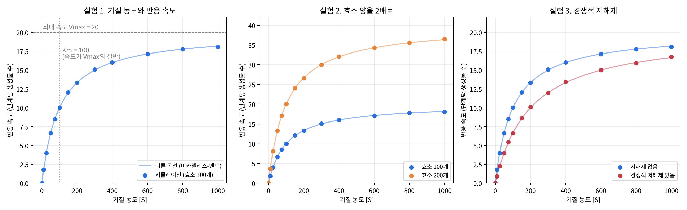

# 효소 반응 속도 시뮬레이션

고2 「세포와 물질대사」 탐구 활동. Python 확률 모델로 효소 반응 속도가 기질 농도, 효소 양, 경쟁적 저해제에 따라 어떻게 달라지는지 시뮬레이션하고, 미카엘리스-멘텐 식의 이론값과 비교했다.



## 실행 방법

```
pip install numpy matplotlib
python enzyme_sim.py
```

실행하면 결과 표가 화면에 출력되고 `enzyme_results.png` 그래프가 저장된다. 난수 씨앗을 2026으로 고정해 매번 같은 결과가 나온다.

## 모델

- 효소 하나하나가 매 단계 '빈 상태(E)', '기질과 결합한 상태(ES)', '저해제와 결합한 상태(EI)' 중 하나에 있다.
- ES는 확률 k = 0.2로 생성물을 만들고 빈 효소가 된다.
- 빈 효소는 확률 a[S] / (1 + a[S]) (a = 0.002)로 기질과 결합한다. 저해제가 있으면 같은 방식으로 저해제와 경쟁한다.
- 이론값: v = Vmax[S] / (Km(1 + [I]/Ki) + [S]), Vmax = 효소 수 × k, Km = 100, Ki = 100

## 주요 결과

| 실험 | 결과 |
| --- | --- |
| 기질 농도 0~1000 | 농도가 높아질수록 최대 속도 20에 가까워짐 (포화) |
| 효소 2배 | 속도 약 2배, Km은 100 그대로 |
| 경쟁적 저해제 | [S]=100에서 10.0 → 6.7, [S]=1000에서 18.1 → 16.8 |
| 이론값과 비교 | 평균 오차 0.5%, 최대 3.2% |

## 탐구 보고서

**탐구 주제**: Python으로 효소 반응 속도 시뮬레이션하기 (기질 농도, 효소 양, 경쟁적 저해제에 따른 변화)

**탐구 동기**: 75쪽 「효소의 정체는 어떻게 밝혀졌을까?」를 읽고, 부흐너와 섬너의 발견을 거쳐 효소의 정체가 밝혀진 과정이 흥미로웠다. 효소가 단백질 분자라면 기질과 결합했다 떨어지는 과정을 프로그램으로 재현할 수 있을지 궁금해졌다. 수업에서 배운 기질 농도와 반응 속도 그래프가 왜 점점 평평해지는지도 직접 확인해 보고 싶어 Python 시뮬레이션으로 탐구했다.

**탐구 방법**: 효소 100개가 '빈 상태'와 '기질과 결합한 상태(효소-기질 복합체)'를 오가도록 했다. 빈 효소는 기질 농도가 높을수록 결합 확률이 커지고, 결합한 효소는 매 단계 20% 확률로 생성물을 만든 뒤 다시 빈 효소가 된다. 2000단계 동안의 평균 생성물 수를 반응 속도로 정하고, 기질 농도(0~1000), 효소 수(2배), 경쟁적 저해제 유무를 바꿔 미카엘리스-멘텐 식의 이론값과 비교했다.

**탐구 결과**: 기질 농도가 낮을 때는 속도가 농도에 거의 비례했지만, 높아질수록 증가 폭이 줄어 최대 속도 20에 가까워졌다. 효소 대부분이 이미 기질과 결합해 있어 반응할 빈 효소가 거의 없기 때문이다. 이를 통해 교과서 그래프가 왜 그런 모양인지 이해할 수 있었다. 효소를 2배로 늘리자 속도도 약 2배가 되었지만, 속도가 최대의 절반이 되는 기질 농도는 100으로 그대로였다. 이 값은 효소의 양이 아니라 효소와 기질의 결합 정도로 정해지기 때문이다. 저해제는 기질 농도 100에서 속도를 10.0에서 6.7로 낮췄지만, 기질 농도 1000에서는 차이가 18.1과 16.8로 줄었다. 기질이 많을수록 저해제보다 기질이 먼저 효소에 결합하기 때문으로 보인다. 결과는 이론값과 평균 0.5%만 차이 났다.

**느낀 점과 진로 연결**: 처음 만든 프로그램은 기질 농도가 높을 때 결합 확률이 1을 넘어가 이론값과 맞지 않았고, 식을 고친 뒤에야 일치했다. 규칙 하나만 잘못 정해도 결과가 달라지므로 시뮬레이션도 이론이나 실험으로 검증해야 한다는 것을 배웠다. 교과서 그래프가 단순한 규칙에서 저절로 나타난다는 점도 인상 깊었다. 다만 온도와 pH의 영향은 다루지 못해, 다음에는 이를 추가하거나 감자의 카탈레이스로 실제 실험을 해 비교해 보고 싶다. 앞으로 컴퓨터공학을 공부해, 약이 효소를 얼마나 억제할지 미리 계산하는 시뮬레이션으로 신약 개발 분야에 기여하고 싶다.
